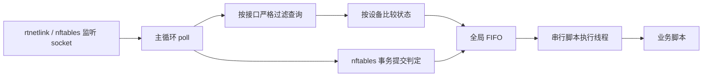

# 结构与事件生命周期

## 模块职责

| 模块 | 职责 |
| --- | --- |
| `options`、`config` | 启动参数、配置读取、实际设备范围 |
| `netlink/transport` | socket、poll、datagram 接收、丢失识别 |
| `netlink/query` | 请求与 sequence、单次查询、按条件严格过滤 dump |
| `netlink/filter` | socket BPF 生成和 ifindex 更新 |
| `netlink/codec` | link、address、route 消息与属性解码 |
| `netlink::Reader` | 按配置接口索引与 DHCPv6 协议读取并规范化快照 |
| `source` | rtnetlink 监听与事件提取 |
| `model`、`event` | 状态模型、差异比较、当前状态事件 |
| `nftables` | 全命名空间 table 基线、事务跟踪、reload 判定 |
| `scheduler` | 设备状态缓存、全局 FIFO、待处理状态合并 |
| `runner` | 脚本排序、环境变量与 JSON、pidfd 超时和进程组回收 |
| `logging`、`main` | JSON 行日志、单循环复用 poll、扫描与进程信号 |

事件源通过领域状态或已确认的动作提交任务，脚本执行层接收 `ScriptEvent`。rtnetlink 和 nftables 共用查询与 socket 实现。

## 接收与扫描

启动时读取配置，订阅通知，再建立状态基线。rtnetlink 监听 link、IPv4/IPv6 address 与 route；nftables 监听整个网络命名空间。设备白名单为空时仅运行 nftables 事件源。

rtnetlink 监听 socket 通过 `SO_ATTACH_FILTER` 安装 BPF：放行 link 通知，地址按已知 ifindex 匹配，路由按 DHCP 协议、`RTA_OIF`、`RTA_IIF` 和 `RTA_MULTIPATH` 匹配。nftables 监听 socket 通过 BPF 仅接收 table 生命周期与 `NFT_MSG_NEWGEN` 提交消息，在内核丢弃高频 set/map element 与 rule 更新。相关 link 通知或通知丢失后重新读取设备索引并更新过滤器。

查询 socket 启用 `NETLINK_GET_STRICT_CHK`：按接口名查询单条 link，按已知 ifindex 查询对应地址与输出路由，并查询 `rtm_protocol == 16` 的 DHCPv6 路由（含专用路由表中的 `unreachable` PD 路由）。在大规模 BGP 路由与多隧道环境下，内核仅返回监控接口关联的对象，避免全量遍历主路由表。

查询 socket 与监听 socket 分开使用。主线程通过单一 `poll` 同时监听 rtnetlink 和 nftables socket，每轮接收最多 256 个 datagram。

rtnetlink 监听 socket 请求 4 MiB 接收缓冲区，nftables 监听 socket 请求 256 KiB 接收缓冲区。具备 `CAP_NET_ADMIN` 时使用 `SO_RCVBUFFORCE`，权限不足时使用 `SO_RCVBUF`。

## 状态与调度

快照规范化地址与路由顺序。比较使用地址、前缀、可用性/首选状态和路由属性集合。路由协议来自 `rtm_protocol`，`RTA_TABLE` 优先于 `rtm_table`；PPP 本地地址来自 `IFA_LOCAL`，peer 来自 `IFA_ADDRESS`。变化标志的定义见 [脚本事件格式](events.md)。

调度器为每个配置设备保存最近观测状态、上次分发状态、首次恢复任务和一个最新待处理任务。首次恢复任务保持启动扫描的状态与零变化标志。运行期间的观测单独排队；新出现的设备从已知不存在状态比较。

所有事件源共用一个脚本执行线程，任务按 FIFO 排队。一个任务中的脚本执行完成后处理下一个任务。正在执行或排队的设备发生后续变化时，更新其待处理状态；完成当前调用后将后续任务加入队尾。每个设备在队列中最多占一个位置，慢脚本期间的连续更新合并为最新状态，`coalesced_updates` 记录合并次数。

变化标志根据上次分发状态与本次当前状态计算。排队期间出现 A → B → A 状态往返且最终状态与上次分发状态一致时，取消本次无变化分发。

nftables 为已确认的 reload 保存计数，每次确认对应一次目录调用。合并后保留最近的 table 元数据，generation 为 `null`。每次执行一个 reload 后返回队尾，使其他任务继续处理。比较基线在分发时推进，脚本失败记录结果后继续执行独立脚本和后续任务。

## 恢复与执行

`ENOBUFS`、`NLMSG_OVERRUN` 或 datagram 截断触发重新扫描。rtnetlink 保留已知状态，用正常接口动作分发，原因为 `netlink_loss`。当前状态相同时恢复调用的地址与 PD 标志为零。

不完整 dump 丢弃整份快照，保留比较基线，记录 `snapshot_incomplete`，等待 100 ms 后再次扫描。其他查询或接收错误由主进程记录并退出，systemd 按 `Restart=on-failure` 恢复。`SIGHUP` 核对当前状态，原因为 `manual`。

脚本使用固定 `/bin/sh` 和独立路径参数启动，目录内普通文件按名字节序排序。每个脚本通过环境变量、事件文件和 stdin 获取同一事件。子进程环境由固定 `PATH`、`LANG=C` 和事件变量组成。

子进程通过 `pidfd_open` 与 `poll` 等待退出，避免固定轮询睡眠延迟。单个脚本超时为 30 秒；超时向进程组发送 `SIGTERM`，等待最多 1 秒后发送 `SIGKILL`，并回收主进程。正常结束后也回收同一进程组中的后台子进程。`SIGTERM`、`SIGINT` 停止任务并终止当前脚本。

日志为 JSON 行，记录时间、级别、事件、设备、目录、脚本、退出码、耗时及终止原因。事件文件在本次目录调用期间有效，结束后删除。

## nftables reload

监听 socket 先订阅 `NFNLGRP_NFTABLES` 并挂载 BPF 过滤。基线查询依次读取 generation、全部 family 的 table、generation；两次 generation 一致且 dump 完整时接受基线。扫描期间的通知保留在监听 socket 中。

table 新增、删除通知按顺序保留，等待 `NFT_MSG_NEWGEN` 后处理。当前 table 集合由非空变为空，表示整个规则集清空；随后创建 table，且重建事务提交时规则集非空，确认一次 reload。原子清空与重建在同一事务确认；分步加载在清空事务提交后继续等待重建。

普通 rule、set/map elements 更新在内核 BPF 层直接过滤；`NFT_MSG_NEWGEN` 确认事务提交。启动和丢失恢复从已提交 generation 建立基线，跳过已包含在基线中的排队事务。
